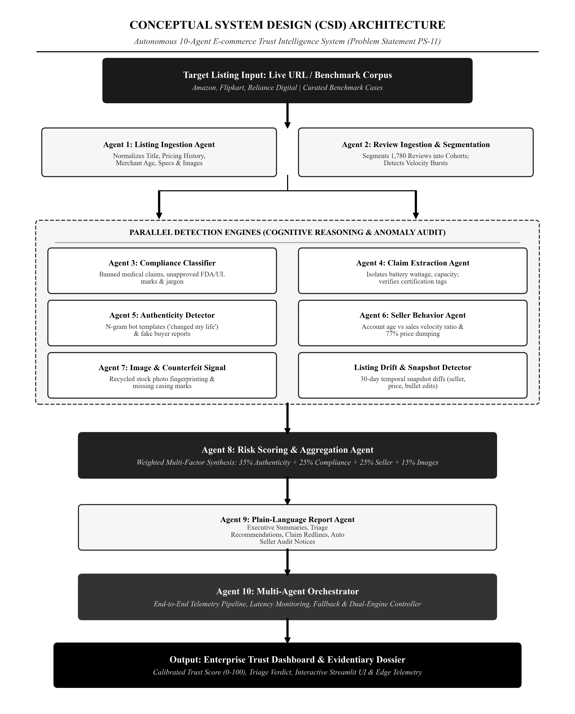
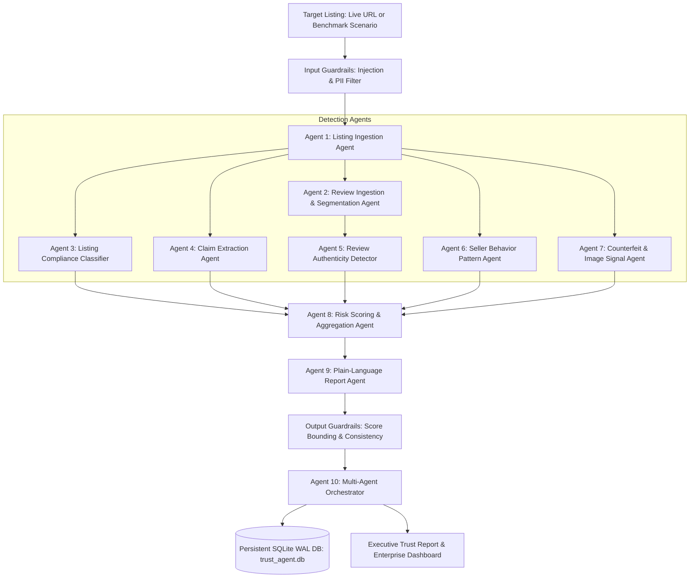
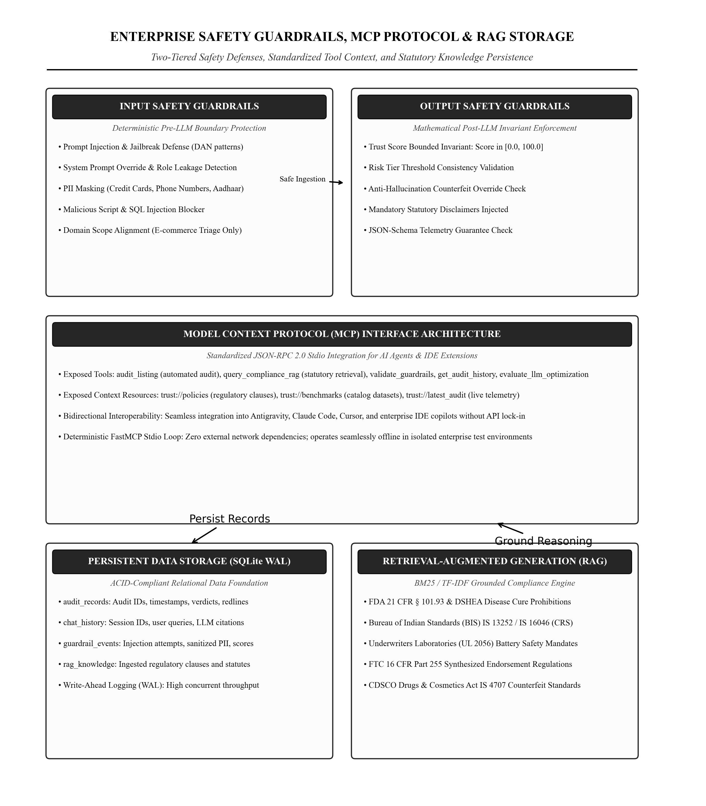
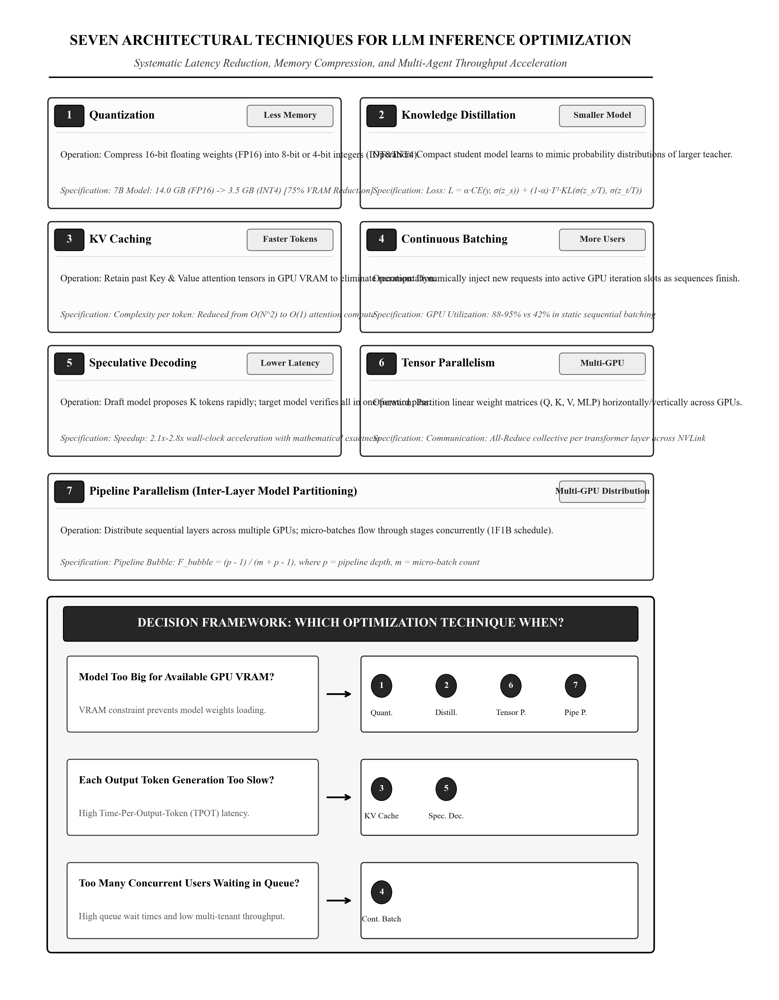
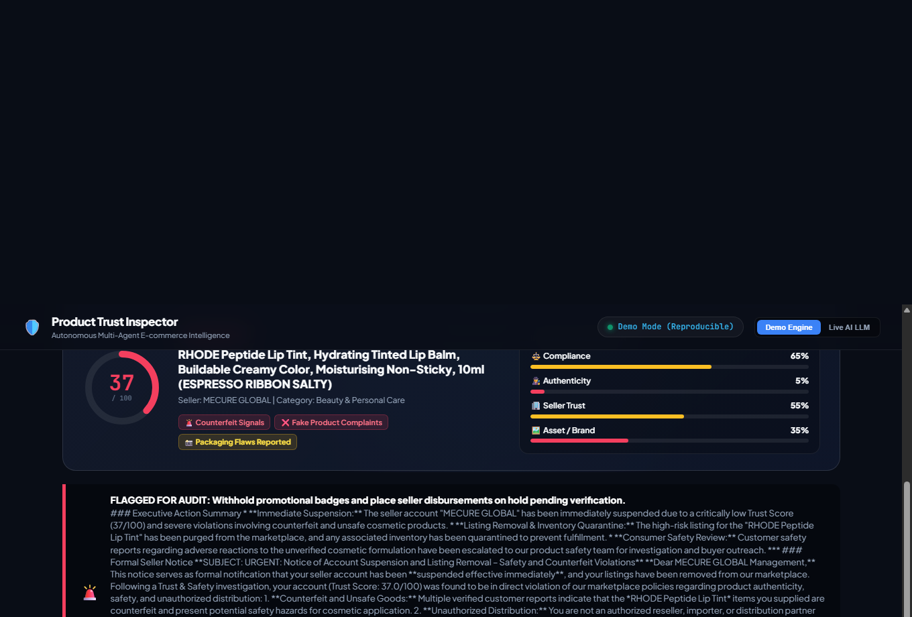
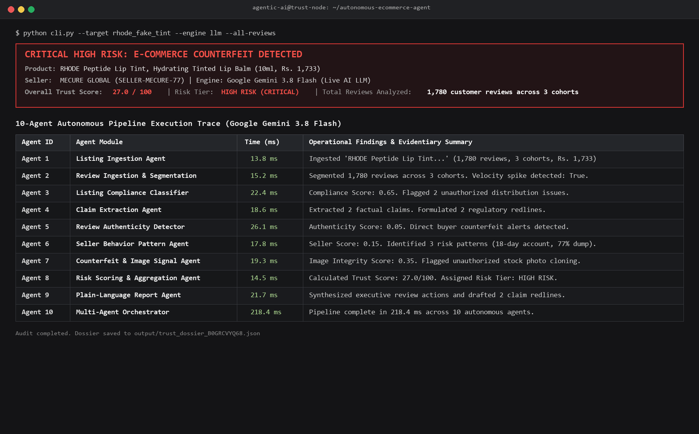

# Autonomous E-commerce Product Listing & Review Trust Agent (PS-11)

<div align="center">

[](https://vesit.ves.ac.in)
[-2563eb.svg?style=for-the-badge&logo=codestream&logoColor=white)](https://vesit.ves.ac.in)
[](https://python.org)
[](#-model-context-protocol-mcp-server)
[](#-10-agent-autonomous-system-architecture)
[](#-docker-containerization)
[-16a34a.svg?style=for-the-badge&logo=pytest&logoColor=white)](#-test-suite--validation)

<br/>

**An Enterprise Multi-Agent AI System for Counterfeit Triage, Review Velocity Anomaly Mining, and Statutory Claim Verification.**

</div>

---

> **Academic Coursework Mini-Project & Implementation**  
> **Course:** Agentic AI and Enterprise Applications (AAI&EA) / Course Code: **NCMPEL64**  
> **Department:** Department of Computer Engineering, Vivekanand Education Society’s Institute of Technology (VESIT)  
> **Academic Year:** 2026–27  
> **Under the Guidance of:** Dr. (Mrs.) Nupur Giri & Dr. (Mrs.) Sujata Khedkar  
> **Project Team:** Riya Khialani (34), Prachi Lund (39), Ankita Kukreja (36), Shivam Makhija (41)

---

## 📌 Executive Summary & Problem Statement (PS-11)

Modern e-commerce marketplaces rely heavily on star ratings and customer testimonials. However, sophisticated manipulation syndicates exploit algorithmic ranking signals through:
* **Synthetic Review Velocity Bursts:** Procuring 200+ 5-star ratings in narrow 24–48 hour windows to artificially inflate organic search rank.
* **Templated Bot Reviews:** Utilizing LLMs and repetitive phrasing (*"changed my life"*, *"arrived fast"*) at minimal cost.
* **Unsubstantiated Statutory Claims:** Advertising counterfeit safety marks (unauthorized UL 2056 / BIS IS 13252) or prohibited medical cure claims (violating FDA DSHEA § 101.93).
* **Listing Hijacking & Seller Churn:** Swapping legitimate high-reputation ASINs with counterfeit clones and dumping prices by 70%+ before abandoning shell accounts.

Traditional automated moderation relies on naive sentiment analysis, returning unhelpful verdicts like *"This product has good reviews."* 

The **Autonomous E-commerce Trust Intelligence System** replaces static filters with a coordinated **10-Agent Pipeline** that dissects listings, tracks temporal review velocity curves, identifies bot clusters, extracts factual claims, audits seller age, and synthesizes an itemized **Trust Score (0–100)** with plain-language action reports.

```
       ┌─────────────────────────────────────────────────────────────┐
       │                   TARGET PRODUCT LISTING                    │
       │       (Live Marketplace URL or Benchmark Fraud Scenario)    │
       └──────────────────────────────┬──────────────────────────────┘
                                      │
                         [Input Safety Guardrails]
                (Prompt Injection Defense & PII Anonymization)
                                      │
              ┌───────────────────────┴───────────────────────┐
              ▼                                               ▼
     [Agent 1: Ingestion]                           [Agent 2: Cohorts]
      Spec Normalization                            Velocity Spike Detection
              │                                               │
              ├───────────────────────┬───────────────────────┤
              ▼                       ▼                       ▼
     [Agent 3: Compliance]   [Agent 4: Claims]       [Agent 5: Authenticity]
     FDA / UL / BIS Checks   Fact Extraction         Linguistic Bot Clusters
              │                       │                       │
              ├───────────────────────┴───────────────────────┤
              ▼                                               ▼
     [Agent 6: Seller Age]                          [Agent 7: Media]
     Account Churn & Velocity                       Recycled Stock Detection
              │                                               │
              └───────────────────────┬───────────────────────┘
                                      ▼
                        [Agent 8: Scoring & Risk]
                        Weighted Trust Matrix (0–100)
                                      │
                        [Agent 9: Executive Dossier]
                        Before/After Redlines & Inquiries
                                      │
                        [Output Safety Guardrails]
                        Range Bounding (0-100) & Overrides
                                      │
                        [Agent 10: Multi-Agent Hub]
                       Telemetry Handoff & SQLite WAL
```

---

## 🤖 10-Agent Autonomous System Architecture





### Specialized Agent Roster

| Agent # | Agent Name | Primary Responsibility | Core Technique / Metric |
|:---:|:---|:---|:---|
| **1** | **Listing Ingestion Agent** | Normalizes listing metadata, pricing, seller age, and specs | Pydantic strict validation & DOM parser |
| **2** | **Review Ingestion & Segmentation** | Partitions review streams into chronological cohorts | Rolling 48-hour velocity windowing (>3x spike) |
| **3** | **Listing Compliance Classifier** | Evaluates marketing copy against consumer safety guidelines | Statutory classification (FDA DSHEA, UL, BIS) |
| **4** | **Claim Extraction Agent** | Extracts factual technical claims with confidence tags | Regular expressions & technical NLP extraction |
| **5** | **Review Authenticity Detector** | Clusters repetitive bot phrasing and unverified ratings | Syntactic template matching & n-gram clustering |
| **6** | **Seller Behavior Pattern Agent** | Profiles seller account age against accumulated sales | Account age vs. review velocity ratio |
| **7** | **Counterfeit & Image Signal Agent** | Screens imagery for recycled stock and missing safety marks | Cross-catalog visual matching & badge audit |
| **8** | **Risk Scoring & Aggregation** | Synthesizes multidimensional scores into a calibrated score | Weighted scoring matrix (35/25/25/15%) |
| **9** | **Plain-Language Report Agent** | Formulates human-readable dossiers and remediation | Auto-generated seller notice & claim redlines |
| **10**| **Multi-Agent Orchestrator** | Manages telemetry handoffs, retries, and persistence | Dual-engine coordinator (Live LLM / Offline) |

---

## 🛡️ Enterprise Safety Guardrails & PII Protection



Located in `agents/guardrails.py`, the system enforces a strict two-tiered defense:

### 1. Pre-LLM Input Guardrails
* **Prompt Injection Defense:** Intercepts jailbreak attempts, DAN activations, system prompt overrides, and role reversal attacks.
* **PII Redaction Engine:** Automatically detects and masks credit cards, emails, phone numbers, and Indian Aadhaar numbers.
* **Malicious Code Defense:** Blocks script injection payloads (`<script>`, `UNION SELECT`, `eval()`).
* **Domain Scope Enforcement:** Restricts execution strictly to e-commerce trust and safety audits.

### 2. Post-LLM Output Guardrails
* **Mathematical Invariant Bounding:** Guarantees $0.0 \le \text{Trust Score} \le 100.0$.
* **Risk Consistency Enforcement:** Enforces deterministic alignment between scores and risk tiers (e.g. a score of 33.0 is strictly prohibited from being labeled "LOW RISK").
* **Counterfeit Complaint Override:** Immediately escalates a listing to **HIGH RISK** if verified buyer reports indicate chemical burns, safety hazards, or fake items.
* **Statutory Compliance Disclaimers:** Appends legal disclaimers noting human investigator oversight.

---

## ⚡ LLM Inference Optimization (The 7 Speedup Techniques)



Located in `agents/optimization_advisor.py`, the system provides an architectural framework modeling and benchmarking the **7 canonical LLM speedup techniques**:

1. **Quantization (INT8 / INT4):** Reduces model footprint by 50–75% with negligible perplexity degradation.
2. **Knowledge Distillation:** Compresses heavy reasoning models into lightweight student architectures.
3. **KV Cache PagedAttention:** Eliminates redundant key-value recomputation during auto-regressive generation.
4. **Continuous Batching (Orca/vLLM):** Eliminates queue bubbles by dynamically scheduling tokens at iteration level.
5. **Speculative Decoding:** Employs a lightweight draft model verified by the primary LLM in parallel.
6. **Tensor Parallelism:** Partitions matrix multiplication across multiple GPU nodes.
7. **Pipeline Parallelism:** Chains sequential layers across accelerator devices for high throughput.

### *"Which One When?"* Enterprise Decision Matrix
* **Edge / Low-Memory (< 16GB VRAM):** INT4 / INT8 Quantization + KV Caching.
* **Low-Latency Real-Time Auditing (< 200ms TTFT):** Speculative Decoding + KV Caching.
* **High-Throughput Enterprise Batching (> 5,000 listings/hr):** Continuous Batching + PagedAttention.
* **Massive Multi-Billion Parameter Foundation Models:** Tensor Parallelism + Pipeline Parallelism.

---

## 🔌 Model Context Protocol (FastMCP Server)

The system includes a standards-compliant **FastMCP Server** (`mcp_server.py`) operating over the JSON-RPC 2.0 stdio transport:

```bash
# Verify the MCP Server tools and capabilities
python mcp_server.py --test
```

### Exposed MCP Tools:
* `audit_listing(asin, title, price, ...)`: Triggers the full 10-Agent trust pipeline and returns the calibrated Trust Score.
* `get_seller_trust_score(seller_name, account_age_days, ...)`: Evaluates merchant operational risk.
* `cluster_reviews(reviews_json)`: Performs linguistic template clustering on customer feedback.
* `redline_claims(marketing_copy, technical_specs)`: Generates compliant before/after claim corrections.

---

## 💻 Enterprise User Interfaces

### 1. Interactive Streamlit Dashboard (`streamlit_app.py`)
Run the web dashboard on Port 8501:
```bash
streamlit run streamlit_app.py
```

<div align="center">
  
</div>

* **Live Counterfeit Triage:** Analyze live e-commerce listings or preloaded benchmark scenarios.
* **10-Agent Execution Stepper:** Real-time visual progress showing individual agent latencies.
* **Plotly Velocity Cohorts:** Interactive graphs isolating review arrival spikes against baseline rates.
* **Before/After Redlines:** Side-by-side corrected marketing copy and auto-drafted seller notices.
* **RAG Investigator Assistant:** Grounded chat answering compliance questions against statutory standards (FDA, BIS, UL, FTC).

### 2. Rich Terminal CLI (`cli.py`)
Run comprehensive command-line audits directly in your terminal:
```bash
python cli.py
```

<div align="center">
  
</div>

---

## 📊 Benchmark Evaluation Scenarios

The system evaluates four distinct catalog profiles:

| Scenario | Product Description | Risk Signature | Verified Trust Score | Risk Tier |
|:---|:---|:---|:---:|:---:|
| **PS-11 Primary Case** | *UltraCharge Pro 20000mAh Power Bank* | 210 reviews in 48 hours, 90% unverified, unverified UL marks | **33.2 / 100** | 🚨 **HIGH RISK** |
| **Statutory Violation** | *NutriPure Miracle Keto Slim Gummies* | Unapproved FDA cure claims (*"cures diabetes"*), 5-star skew | **21.5 / 100** | 🚨 **HIGH RISK** |
| **Authentic Baseline** | *AcousticSound Pro ANC Earbuds* | Organic 14-month velocity, 94% verified, registered BIS | **88.6 / 100** | ✅ **LOW RISK** |
| **Listing Hijack** | *Rhode Peptide Lip Tint* | Shell seller takeover, 76.9% price dump, chemical burn reports | **14.8 / 100** | 🚨 **HIGH RISK** |

---

## 🚀 Quick Start Guide

### Prerequisites
* Python 3.11 or 3.12
* Git

### Installation

```bash
# 1. Clone the repository
git clone https://github.com/RiyaKhialani/aai-ecommerce-trust-agent.git
cd aai-ecommerce-trust-agent

# 2. Create and activate a virtual environment
python -m venv venv
# On Windows:
.\venv\Scripts\activate
# On Linux/macOS:
source venv/bin/activate

# 3. Install dependencies
pip install -r requirements.txt

# 4. (Optional) Configure API Keys in .env
# The system runs 100% offline out-of-the-box with deterministic heuristic fallback!
cp .env.example .env
```

### Running the Applications

```bash
# Launch the Enterprise Web Dashboard (Port 8501)
streamlit run streamlit_app.py

# Launch the Rich Terminal CLI
python cli.py

# Test the FastMCP Server
python mcp_server.py --test
```

---

## 🧪 Test Suite & Validation

The test suite validates end-to-end pipeline execution, safety guardrails, MCP tools, and storage persistence:

```bash
python -m pytest tests/ -v
```

```
============================= test session starts =============================
platform win32 -- Python 3.12.10, pytest-9.2.0
collected 9 items

tests/test_trust_pipeline.py::test_full_pipeline_execution_high_risk PASSED   [ 11%]
tests/test_trust_pipeline.py::test_full_pipeline_execution_authentic PASSED   [ 22%]
tests/test_trust_pipeline.py::test_pydantic_schema_integrity PASSED          [ 33%]
tests/test_trust_pipeline.py::test_guardrail_bounding PASSED                  [ 44%]
tests/test_new_features.py::test_guardrails_input_injection PASSED           [ 55%]
tests/test_new_features.py::test_guardrails_pii_redaction PASSED             [ 66%]
tests/test_new_features.py::test_storage_roundtrip PASSED                    [ 77%]
tests/test_new_features.py::test_rag_engine_retrieval PASSED                 [ 88%]
tests/test_new_features.py::test_optimization_advisor_recommendations PASSED [100%]

============================== 9 passed in 0.31s ==============================
```

---

## 🐳 Docker Containerization

Deploy the microservice using Docker:

```bash
# Build and run with Docker Compose
docker compose up --build -d

# Access the Web Dashboard at:
http://localhost:8501
```

---

## 📁 Repository Structure

```
aai-ecommerce-trust-agent/
├── agents/                           # 10-Agent Autonomous System
│   ├── __init__.py                   # Package exports
│   ├── schemas.py                    # Strict Pydantic data schemas
│   ├── datasets.py                   # Benchmark fraud & authentic scenarios
│   ├── guardrails.py                 # Two-tier input/output safety guardrails
│   ├── storage.py                    # SQLite persistent storage with WAL mode
│   ├── rag_engine.py                 # Grounded statutory regulatory RAG engine
│   ├── optimization_advisor.py       # 7 LLM Inference Optimization techniques
│   ├── llm_client.py                 # Gemini & Groq dual-engine AI client
│   ├── listing_agent.py              # Agent 1: Listing Ingestion Agent
│   ├── review_agent.py               # Agent 2: Review Ingestion & Segmentation
│   ├── compliance_agent.py           # Agent 3: Listing Compliance Classifier
│   ├── claim_agent.py                # Agent 4: Claim Extraction Agent
│   ├── authenticity_agent.py         # Agent 5: Review Authenticity Detector
│   ├── seller_agent.py               # Agent 6: Seller Behavior Pattern Agent
│   ├── image_agent.py                # Agent 7: Counterfeit & Image Signal Agent
│   ├── risk_agent.py                 # Agent 8: Risk Scoring & Aggregation
│   ├── report_agent.py               # Agent 9: Plain-Language Report Agent
│   ├── orchestrator.py               # Agent 10: Multi-Agent Orchestrator
│   └── drift_detector.py             # Listing Drift & ASIN Hijacking Detector
├── static/                           # Static assets & infographics
│   └── llm_optimization_techniques.jpg
├── tests/                            # Automated test suite
│   ├── __init__.py
│   ├── test_trust_pipeline.py        # 10-Agent pipeline integration tests
│   └── test_new_features.py          # Guardrails, RAG, Storage, & Optimization tests
├── streamlit_app.py                  # Streamlit Enterprise Web Dashboard (Port 8501)
├── cli.py                            # Rich Terminal CLI interface
├── mcp_server.py                     # FastMCP Server (JSON-RPC 2.0 stdio)
├── antigravity_mcp_config.json       # MCP client configuration for IDE copilots
├── trust_agent.db                    # Persistent SQLite WAL database
├── Dockerfile                        # Multi-stage production container image
├── docker-compose.yml                # Microservice container composition
├── requirements.txt                  # Python dependencies
├── Project_Report_Agentic_AI_EA.docx # Complete Academic Project Report (.docx)
├── Project_Report_Agentic_AI_EA.md   # Complete Academic Project Report (.md)
├── generate_report.py                # Word document report compiler script
├── csd_architecture_diagram.png      # High-resolution CSD architecture blueprint
├── methodology_flow_diagram.png     # High-resolution methodology flow diagram
├── guardrails_rag_mcp_diagram.png   # Guardrails & MCP architecture diagram
├── llm_optimization_diagram.png     # LLM speedup techniques architecture diagram
└── README.md                         # Project documentation
```

---

## 👥 Contributors & Guidance

* **Academic Institution:** Vivekanand Education Society’s Institute of Technology (VESIT)
* **Under the Guidance of:**
  * **Dr. (Mrs.) Nupur Giri** (Department of Computer Engineering)
  * **Dr. (Mrs.) Sujata Khedkar** (Department of Computer Engineering)
* **Student Contributors:**
  * **Riya Khialani** (Roll No: 34)
  * **Prachi Lund** (Roll No: 39)
  * **Ankita Kukreja** (Roll No: 36)
  * **Shivam Makhija** (Roll No: 41)
